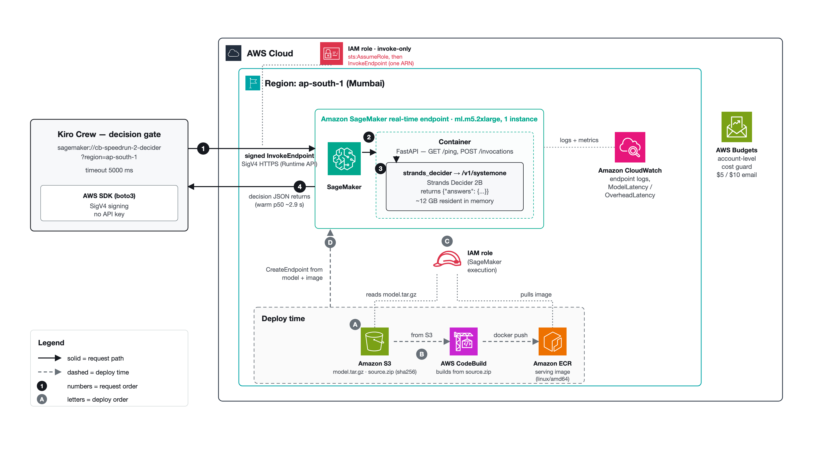

# Strands Decider 2B on Amazon SageMaker

Deploy Kiro Crew's decision model — **Strands Decider 2B** — to an **Amazon
SageMaker real-time endpoint** in your own AWS account, point Kiro Crew's
`sagemaker://` decision route at it, verify it, benchmark it, and tear it all down
with one script. A complete, reproducible path from **deploy → verify → connect →
benchmark → clean up**, with pinned weights, a least-privilege IAM story, and a
cost guard.

Strands Decider 2B is the small, open decision model Kiro Crew can run instead of
the default hosted "Jev" service. Self-hosting it on SageMaker sends each decision
to an endpoint in your own account, SigV4-signed with your own credentials,
instead of to a third-party API.

**Verified end to end:** Kiro Crew 0.12.0's gateway sent live `tool.risk`
decisions to this endpoint and got answers in 2.2 to 8.9 s, matched one for one by
CloudWatch invocations. The limit: the 39-candidate skill choice takes ~32 s on
CPU, past Kiro Crew's 10 s wait cap. See [Gateway proof](#gateway-proof) and
[Which decisions fit](#which-decisions-fit).

> This repo deploys **nothing by itself**. You run the scripts against your own
> account. Standing up a real-time endpoint costs money while it runs (see
> [Cost](#cost)); `scripts/cleanup.sh` removes everything.

---

## What's in here

```
container/      the SageMaker serving image
  Dockerfile        CPU, linux/amd64, ~2 GB (weights NOT baked in)
  serve.py          FastAPI shim: GET /ping, POST /invocations -> /v1/systemone
  requirements.txt  pins mirroring Kiro Crew 0.12.0's strands-decider-2b deps
  buildspec.yml     CodeBuild build+push (account/region injected, nothing hardcoded)
  tests/test_serve_stub.py   contract test, no model load (passes locally)
weights/        the model artifact
  manifest.json       16 files, each pinned by sha256 + size
  download_weights.py fetch from the public CDN and VERIFY every sha256
  package_model.sh    tar the verified files into model.tar.gz (root-level)
infra/
  template.yaml       one CloudFormation template for the whole stack
scripts/
  deploy.sh           two-pass deploy (foundation, then endpoint)
  verify.py           one signed InvokeEndpoint with the exact gate body
  benchmark.py        N invocations, p50/p90/p99, cold vs warm
  connect_kiro_crew.md  point Kiro Crew at the endpoint + restore
  cleanup.sh          delete everything, then verify each resource is gone
docs/
  diagram.png         architecture diagram
LICENSE             MIT (author: S Logesh)
```

## Architecture



*At request time (solid, 1–4), Kiro Crew's decision gate on the developer's Mac —
signing each call with SigV4 through the AWS SDK (boto3), no API key — makes a
signed `InvokeEndpoint` call (1) to the Amazon SageMaker real-time endpoint
(`ml.m5.2xlarge`, 1 instance) in ap-south-1, which routes to the container (2)
whose FastAPI `/invocations` hands off to the in-container `strands_decider`
`/v1/systemone` model (3, Strands Decider 2B, ~12 GB resident) and returns the
decision JSON (4, warm p50 ~2.9 s), scoped by a global invoke-only IAM role the
caller assumes (`sts:AssumeRole`, then `InvokeEndpoint` on one endpoint ARN). At
deploy time (dashed, A–D), the pinned sha256-verified weights are packaged as
`model.tar.gz` into Amazon S3 (A) and `source.zip` is built by AWS CodeBuild into
an image pushed to Amazon ECR (B); the SageMaker execution IAM role (C) reads the
model from S3 and pulls the image from ECR, and CreateEndpoint (D) stands the
endpoint up from that model and image — with Amazon CloudWatch collecting endpoint
logs and ModelLatency/OverheadLatency, and an account-level AWS Budget sending
$5/$10 email alerts.*

```
                 build time                          serve time
  weights/ ──download_weights.py──▶ model.tar.gz ──▶ S3 bucket ──┐
  (pinned sha256, verified)                                      │
                                                                 ▼
  container/ ──(source.zip)──▶ CodeBuild ──docker push──▶ ECR ──▶ SageMaker
                                  (role: push to ECR,            Model + EndpointConfig
                                   read source from S3)          + Endpoint (ml.m5.2xlarge)
                                                                 │
  Kiro Crew ──sagemaker://name?region=…──SigV4──InvokeEndpoint──▶┘
  (your AWS creds; only sagemaker:InvokeEndpoint; runtime.sagemaker.<region>.amazonaws.com)

  AWS Budget (monthly cap, email alerts)  ◀── guards spend on all of the above
```

Weights live in `model.tar.gz` in S3, **not** in the image — SageMaker extracts
the tarball to `/opt/ml/model` at endpoint creation. That keeps the image small
(~2 GB) and the weights pinned and verifiable independently.

## Prerequisites

- An AWS account and the **AWS CLI v2**, configured for the target account/region.
- **Python 3.10+** with `boto3` (for `verify.py` / `benchmark.py`:
  `pip install boto3`).
- SageMaker **endpoint-usage quota** for your chosen instance type
  (`ml.m5.2xlarge` is usually available; GPU types often need a quota increase).
- ~4 GB free disk for the weights download and the 3.4 GB `model.tar.gz`.
- For the CodeBuild path you need **no local Docker** — CodeBuild builds the image
  in the cloud. (A local `docker build` using `container/Dockerfile` also works.)
- Kiro Crew installed, if you want to route live decisions through the endpoint.

## Deploy → verify → connect → benchmark → clean up

```bash
# 0. Fetch + verify the pinned weights, then package them.
cd weights
python3 download_weights.py          # verifies all 16 sha256 pins
./package_model.sh                   # -> weights/model.tar.gz (refuses if any pin failed)
cd ..

# 1. Deploy (two passes, handled by the script). First arg is your budget email.
./scripts/deploy.sh you@example.com ap-south-1 cb-speedrun-2-decider ml.m5.2xlarge

# 2. Verify with one signed InvokeEndpoint (the exact body Kiro Crew sends).
python3 scripts/verify.py --endpoint cb-speedrun-2-decider --region ap-south-1

# 3. Connect Kiro Crew (record current settings first — see the doc).
#    scripts/connect_kiro_crew.md walks through set endpoint / enable / read log / restore.

# 4. Benchmark: 30 calls, cold vs warm, p50/p90/p99.
python3 scripts/benchmark.py --endpoint cb-speedrun-2-decider --region ap-south-1 -n 30

# 5. Clean up EVERYTHING and verify each resource is gone.
./scripts/cleanup.sh ap-south-1 cb-speedrun-2-decider
```

`deploy.sh` deploys the foundation (S3, ECR, CodeBuild, Budget, IAM) with
`CreateEndpoint=false`, uploads `source.zip` and `model.tar.gz`, runs the build,
then re-deploys with `CreateEndpoint=true` to create the model + endpoint — so you
never pay for an endpoint before the image and weights exist.

## Results

Measured on a real deployment in `ap-south-1` on an `ml.m5.2xlarge` endpoint
(1 instance), called from a Mac in India (2026-11-09). The endpoint was torn down
right after — these are numbers to expect when you reproduce, not a live service.

**What is proven:** **37 signed `InvokeEndpoint` calls** (a smoke call, a 35-call
benchmark, and the invoke-proof) completed with **0 errors**, each carrying Kiro
Crew's exact `/v1/systemone` body and returning a valid answer. A sample answer
came back with a full probability distribution — e.g. `action: "hold"` with
`{merge: 0.14, hold: 0.43, request_changes: 0.43}`, plus `noul` and `score`
answers. The least-privilege invoke-only role was proven end to end:
`InvokeEndpoint` **succeeded** under the assumed role while `DescribeEndpoint` was
**denied**, exactly as scoped.

Those are direct, signed boto3 calls. The gateway-routed proof came in a second
run, below.

### Gateway proof

On the second run (2026-11-09, endpoint InService 21:20:29Z), Kiro Crew's gateway
routed real decisions to the endpoint. Four `tool.risk` decisions in the 21:37Z
minute, from `decisions-20261109.jsonl` (session and turn IDs removed):

| Time (UTC) | Tool | latency_ms | error | Answer | input_tokens |
|---|---|---|---|---|---|
| 21:37:04.718 | `read` | 2180 | null | risk=safe, p=0.5714 | 228 |
| 21:37:23.002 | `session_send` | 4341 | null | risk=caution, p=0.5109 | 519 |
| 21:37:25.238 | `work_ledger_record` | 2226 | null | risk=caution, p=0.4498 | 266 |
| 21:37:48.341 | `shell` | 8933 | null | risk=caution, p=0.3849 | 986 |

Every line names `provider_model: strands-decider-2b`. CloudWatch
(`AWS/SageMaker`, `EndpointName=cb-speedrun-2-decider`, `VariantName=v1`) for the
same minute: **Invocations = 4**, ModelLatency sum **17.38 s** against the
gateway's summed latency_ms of **17.68 s**; the 0.3 s gap is network. 4XX and 5XX
errors were 0 throughout.

Two `skills.select` decisions (39 skill candidates) at 21:24:13Z and 21:24:38Z
also reached the endpoint: one CloudWatch invocation in each of the 21:24 and
21:25 minutes, ModelLatency **31.95 s** and **32.65 s**. Kiro Crew had already
given up and logged `error: "timeout"`.
One more invocation at 21:34Z (ModelLatency 29.4 s) has no matching log line;
most likely a call whose result arrived after the gateway gave up, not confirmed.

To check your own: follow [`scripts/connect_kiro_crew.md`](scripts/connect_kiro_crew.md),
then compare the decision-log lines for one UTC minute with CloudWatch
`Invocations` and `ModelLatency` for that minute.

### Which decisions fit

Each decision point waits at most a fixed cap, whatever
`decisions.provider.timeout_ms` says (`MAX_WAIT_SECS` in Kiro Crew 0.12.0
`kiro_crew/decisions/points/`):

| Decision point | Request size | Latency on ml.m5.2xlarge | Wait cap | Verdict |
|---|---|---|---|---|
| `tool.risk` (Risky tool-call notes) | 228 to 986 input tokens | 2.2 to 8.9 s, measured | 10 s | works |
| `skills.select` (Automatic skill choice) | 39 skill candidates | ~32 s model time, measured | 10 s | too slow on this CPU instance |
| `compaction.keep` | not measured | not measured | 10 s | untested |
| `memory.recall` | not measured | not measured | 7 s | untested |
| `message.steer`, `model.route`, `nudge.wake` | not measured | not measured | `timeout_ms` only | untested |

Production advice: turn on short points like `tool.risk`; keep skill choice on Jev
or the local model, or try a faster instance. The `ml.g4dn.xlarge` endpoint quota
was 0 on the author's account, so a GPU endpoint is untested. The 8.9 s `shell`
check is close to the cap, so long tool inputs may still time out.

### Latency (35 calls, 0 errors)

| Metric | Value |
|---|---|
| Request / response body | 660 B / 492 B |
| Cold start (1st call) | ~3019 ms |
| Warm p50 / p90 / p99 | **2894 / 2933 / 3031 ms** |
| Warm mean (34 calls) | 2903 ms |

A 30-call warm window cross-checked against CloudWatch breaks the ~2.8 s round
trip down: **ModelLatency ~2139 ms** (container compute) + **OverheadLatency
~5 ms** (SageMaker) + **~620 ms** network India↔ap-south-1. Run it from the same
region to cut the network leg.

### Latency follows the number of questions (payload sweep, 15 calls each)

| Request size | p50 |
|---|---|
| 220 B | 893 ms |
| 655 B | 2937 ms |
| 3155 B | 8917 ms |

Bigger bodies mean more questions in one call, and the CPU model answers them
in sequence — so latency scales with question count, not just bytes.

### The container serializes requests — scale with instances, not concurrency

40 calls at each concurrency level, **0 errors** throughout, but throughput is
flat while p50 climbs linearly:

| Concurrent callers | Throughput | p50 |
|---|---|---|
| 1 | 0.36 req/s | 2.8 s |
| 2 | 0.38 req/s | 5.3 s |
| 4 | 0.28 req/s | 14.4 s |
| 8 | 0.29 req/s | 27.2 s |

One `ml.m5.2xlarge` handles ~0.3–0.4 req/s regardless of how many callers pile
on; extra callers just queue. To serve more, add instances (raise
`InitialInstanceCount` / use autoscaling), don't push concurrency at one instance.

### Cost of both runs

| Item | Duration | Cost |
|---|---|---|
| Run 1, attempt 1 (broken image, Failed) | 0.407 endpoint-hours | $0.197 |
| Run 1, attempt 2 (working) | 0.829 endpoint-hours | $0.402 |
| Run 2 (gateway proof) | 0.354 endpoint-hours | $0.172 |
| **Endpoint total** | **1.591 hr** × $0.485 | **$0.77** |
| CodeBuild (3 builds, `GENERAL1_SMALL`) | ~2 to 3 min each | ~$0.04 |
| S3 / ECR storage | — | <$0.01 |
| **Total** | | **≈ $0.81** |

The $10 monthly Budget guarded it. Left running, the same endpoint is ~$354/mo
(see [Cost](#cost)) — which is why `cleanup.sh` runs at the end.

## What CloudFormation creates

One template, `infra/template.yaml` (validated with `cfn-lint`), creates:

| Resource | Purpose |
|---|---|
| **S3 bucket** | `source.zip` (build context) + `model.tar.gz`. SSE-S3, versioned, all public access blocked. |
| **ECR repo** | the serving image; scan-on-push, immutable tags. |
| **CodeBuild project + role** | builds and pushes the image. Role can push to this one repo and read from this one bucket — nothing else. |
| **SageMaker exec role** | pulls this image, reads this `model.tar.gz`, writes its own CloudWatch logs — nothing else. |
| **SageMaker model / endpoint-config / endpoint** | the real-time endpoint (`InstanceType` parameter, default `ml.m5.2xlarge`). Created only when `CreateEndpoint=true`. |
| **Invoke-only managed policy** | grants **only** `sagemaker:InvokeEndpoint` on this one endpoint ARN. Attach it to the principal that should call the endpoint. |
| **AWS Budget** | monthly `BudgetLimitUsd` cap (default $10), email alerts at 50%, 100% actual and 100% forecast. |

No account IDs are baked in — everything derives from `AWS::AccountId` /
`AWS::Region` or template parameters.

## Cost

A real-time endpoint bills **per hour while it exists**, whether or not you call
it. Delete it (`cleanup.sh`) as soon as you're done.

| Instance | Region | $/hr | ~$/month if left on (730 hr) |
|---|---|---|---|
| **ml.m5.2xlarge** (CPU, 32 GB — default) | ap-south-1 (Mumbai) | **$0.485** | **~$354** |
| ml.g4dn.xlarge (GPU) | ap-south-1 (Mumbai) | $0.8106 | ~$592 |

Rates read from the AWS Price List API on 2026-11-09; your region and any
negotiated pricing may differ. CodeBuild (`BUILD_GENERAL1_SMALL`), ECR storage and
S3 storage add a few cents for a short run. The $10 Budget is a guardrail, not a
hard stop — AWS Budgets **alert**, they do not cap spend, so tear down promptly.

## Security notes

- **Least privilege.** The CodeBuild role, the SageMaker execution role and the
  invoke-only policy each name exactly the one bucket / repo / endpoint they need.
  The invoke-only policy grants a single action (`sagemaker:InvokeEndpoint`) on a
  single endpoint ARN.
- **Where requests go.** Kiro Crew's `sagemaker://` route calls only
  `sagemaker:InvokeEndpoint`, always to `runtime.sagemaker.<region>.amazonaws.com`,
  SigV4-signed with your own credentials. No API key is read or sent.
- **S3 is private** (all public access blocked, SSE-S3, versioned); the ECR repo
  scans images on push and uses immutable tags.
- **No secrets in the repo.** There are no account IDs, user ARNs or keys — grep
  the tree (`grep -rE 'AKIA|ASIA|arn:aws:iam::[0-9]+:user'`) and you'll find
  nothing. Supply your account via credentials and the template's parameters.

## Known limits

- **SageMaker Serverless can't host this.** Serverless Inference caps memory at
  **6 GB**, and the model's peak resident memory is ~12 GB — so you need a
  real-time endpoint on a sized instance (hence the hourly cost). Kiro Crew itself
  recommends ~48 GB machine RAM to run it locally.
- **Accuracy vs the hosted Jev model.** On Kiro Crew's 231-item public JevBench,
  Strands Decider 2B matched **~84%** of Jev's correct answers overall and **~69%**
  on the hard tier (measured on one 10-core CPU host — a measurement, not a
  guarantee). It is a smaller model; expect it to miss some decisions Jev gets.
- **Latency.** CPU inference of a 2B model is **seconds, not milliseconds** — this
  deployment measured warm **p50 2894 / p90 2933 / p99 3031 ms** and a ~3019 ms
  cold start (35 calls, 0 errors). The round trip breaks down as ~2139 ms container
  compute + ~5 ms SageMaker overhead + ~620 ms network from India; latency also
  scales with the number of questions in the body (220 B → ~0.9 s, 3155 B →
  ~8.9 s). Fine for Kiro Crew's decision cadence, not for interactive per-token
  use. It also exceeds Kiro Crew's **default 1000 ms decision timeout**, so raise
  `decisions.provider.timeout_ms` before routing live decisions. Raising it past
  10000 does nothing: each decision point clamps its wait to a fixed cap (10 s for
  `tool.risk`, `skills.select` and `compaction.keep`, 7 s for `memory.recall`), so
  the ~32 s skill choice can never finish on this CPU instance (see
  [Which decisions fit](#which-decisions-fit)).
- **One instance serializes requests.** A single `ml.m5.2xlarge` sustains only
  ~0.3–0.4 req/s; concurrent callers queue rather than parallelize (p50 rose
  2.8 s → 27 s from 1 → 8 callers, throughput flat, 0 errors). Scale out with more
  instances (`InitialInstanceCount` / autoscaling), not more concurrency per
  instance.
- **Request size.** SageMaker real-time refuses a body over ~25 MB (Kiro Crew
  enforces a 25 MB client cap), which matters only for image/Box decisions.
- **Null rubrics.** Kiro Crew may send an option rubric as JSON `null`; the strands
  schema rejects that, so `serve.py` rewrites `null → ""` before the model sees it
  (the same fix Kiro Crew's local launcher uses). Covered by the contract test.

## Troubleshooting

Real gaps hit while deploying and verifying this, and how each was fixed:

- **Container crash-loops immediately (SageMaker "ping health check failed").**
  SageMaker starts the container as `docker run <image> serve`, appending `serve`
  as an argument. An **exec-form** `ENTRYPOINT ["python","-m","uvicorn",...]` hands
  that trailing `serve` straight to uvicorn, which rejects it with "unexpected
  extra argument serve" and exits — over and over. The fix (already in
  `container/Dockerfile`) is a shell entrypoint that swallows the arg:
  `ENTRYPOINT ["sh","-c","exec python -m uvicorn serve:app --host 0.0.0.0 --port 8080 --log-level warning"]`
  — `serve` becomes the shell's `$0` and is ignored.
- **SageMaker can't read `model.tar.gz` (`AccessDenied`, model/endpoint fails).**
  The managed `AmazonSageMakerFullAccess` only grants S3 on `*sagemaker*`-named
  buckets, and this stack's bucket isn't one. Diagnose it precisely with
  `aws iam simulate-principal-policy --policy-source-arn <exec-role> --action-names s3:GetObject --resource-arns arn:aws:s3:::<bucket>/model/*`
  (it returns `implicitDeny`). The template's own exec role grants `s3:GetObject`
  on the bucket explicitly, so use that role — not a stock one.
- **The bucket must exist before you upload.** A manual `aws s3 mb` in a
  non–us-east-1 region needs the region's `LocationConstraint`, and a bucket that
  wasn't actually created surfaces later as `NoSuchBucket` on upload. Deploy via
  the template (which creates the bucket in the stack's region) and confirm with
  `aws s3api head-bucket --bucket <name> --region <region>` before uploading.
- **Kiro Crew's decision times out before the endpoint answers.** The default
  decision timeout is **1000 ms**, but a real CPU call to this endpoint takes
  **~2900 ms**, so every decision times out and falls back. Raise it:
  `kirocrew config set decisions.provider.timeout_ms 10000` (higher values are
  clamped to each point's 10 s cap).
- **Kiro Crew keeps calling Jev even after you set the `sagemaker://` endpoint.**
  Consent binds to the endpoint string the dashboard card **displays** when you
  grant it; the consent PUT must echo that string, or it returns `409`. On the
  author's first run a Settings tab loaded before `kirocrew config set` still
  showed the Jev URL, so consent bound to Jev: the gateway's `skills.select`
  decision failed `error: "provider"` in 2 ms and CloudWatch recorded zero
  invocations. **The order that worked on the second run:**
  1. `kirocrew config set` the endpoint, model and `timeout_ms`.
  2. Hard-reload the dashboard.
  3. Check Settings > Developer > Decisions reads "Sent to sagemaker://...".
  4. Then turn on Decisions.
  Consent pins only on/off plus the endpoint string, so later `timeout_ms` changes
  keep it. Full steps: [`scripts/connect_kiro_crew.md`](scripts/connect_kiro_crew.md).
- **Skill choice always times out.** `skills.select` with 39 candidates took ~32 s
  of model time on `ml.m5.2xlarge`, and the point waits at most 10 s
  (`MAX_WAIT_SECS = 10.0` in `skills_select.py`). Leave Automatic skill choice on
  Jev or the local model, or use a faster instance.
- **`CreateModel` fails with a misleading "role is invalid".** A SageMaker
  execution role created in the console often carries the IAM path
  `/service-role/`, so its real ARN is
  `arn:aws:iam::<account>:role/service-role/<RoleName>` — the no-path
  `.../role/<RoleName>` ARN is rejected. Get the exact ARN with
  `aws iam get-role --role-name <RoleName> --query Role.Arn`. (The CloudFormation
  template here creates its own exec role without that path, so this bites only
  when you reuse a console-made role.)
- **GPU instance type rejected at endpoint creation.** `ml.g4dn.xlarge` endpoint
  usage is often quota 0 on a new account — request a quota increase first, or stay
  on `ml.m5.2xlarge`.
- **Weights sha256 mismatch.** `download_weights.py` exits non-zero and
  `package_model.sh` refuses to package. Delete the bad file under `weights/files/`
  and re-run the download; the pins in `manifest.json` are authoritative.

## Clean up

When you're done, delete every resource and verify it's gone:

```bash
./scripts/cleanup.sh ap-south-1 cb-speedrun-2-decider
```

It deletes the endpoint first (stops billing), then the endpoint-config, model,
ECR images, and the CloudFormation stack (bucket, repo, CodeBuild, roles,
invoke-only policy, Budget), then prints a `gone:` / `STILL PRESENT:` line per
resource. It is idempotent — safe to re-run after a partial failure.

## License

MIT © S Logesh. See [LICENSE](LICENSE).
